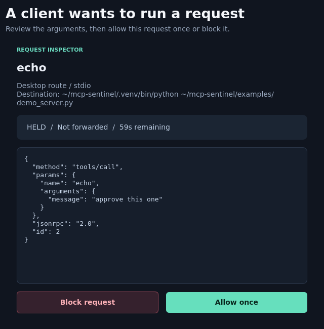
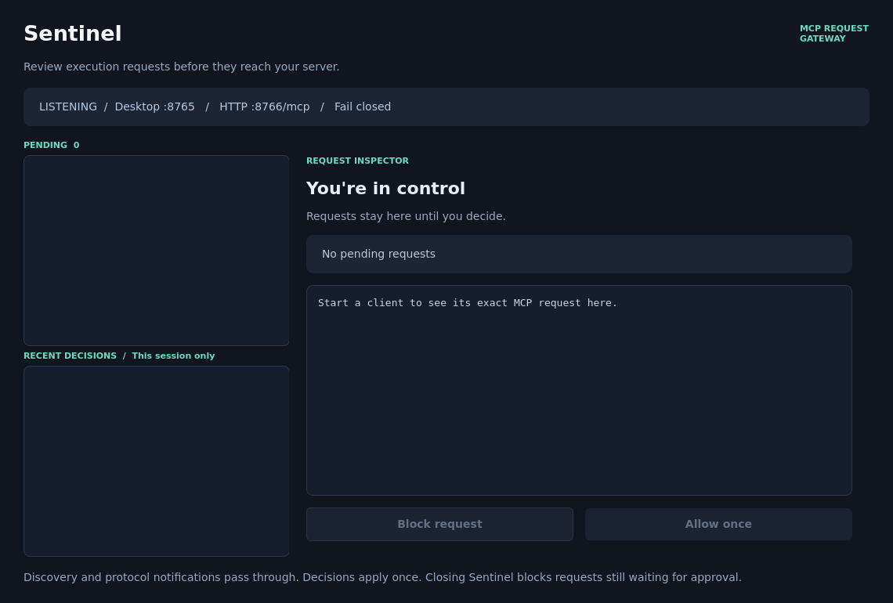
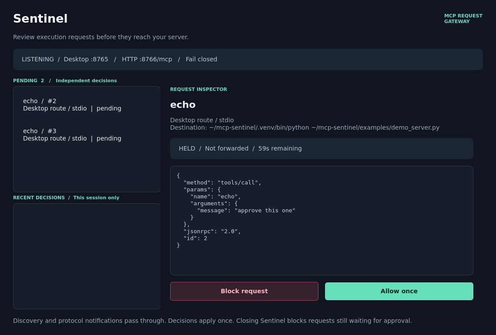
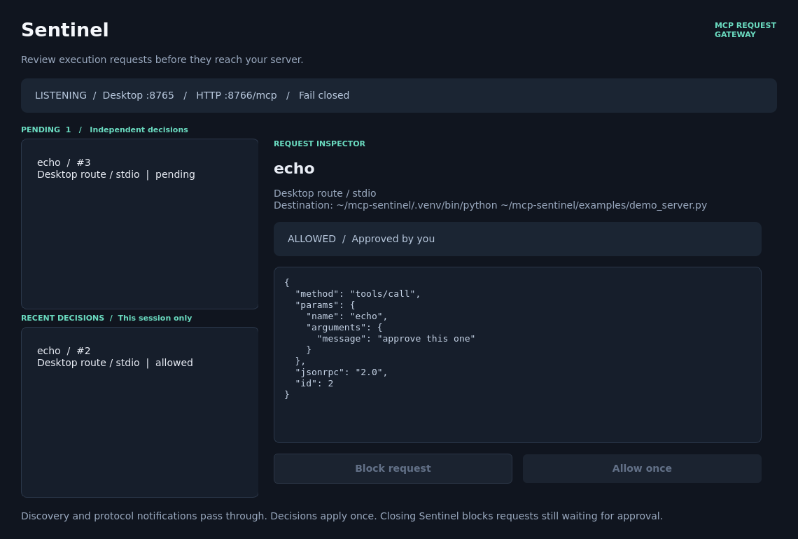
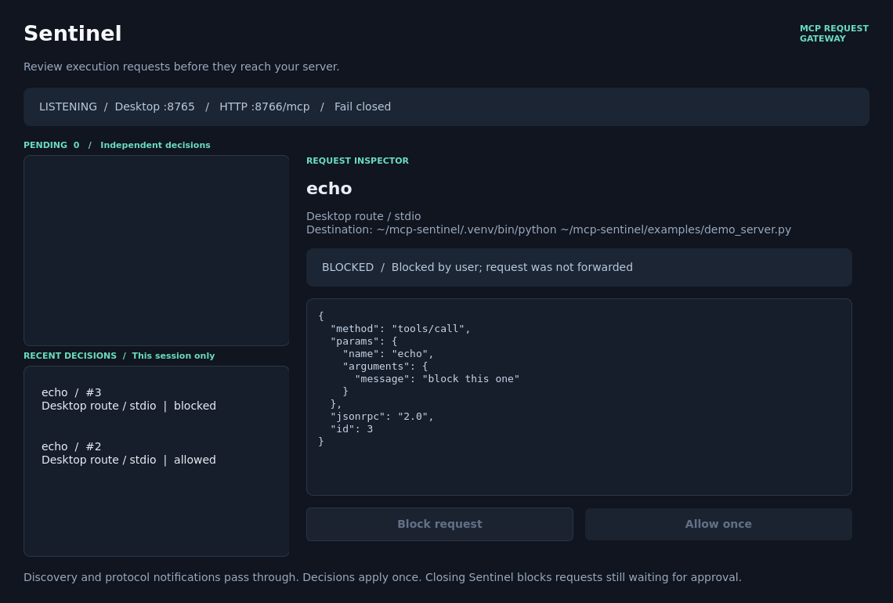
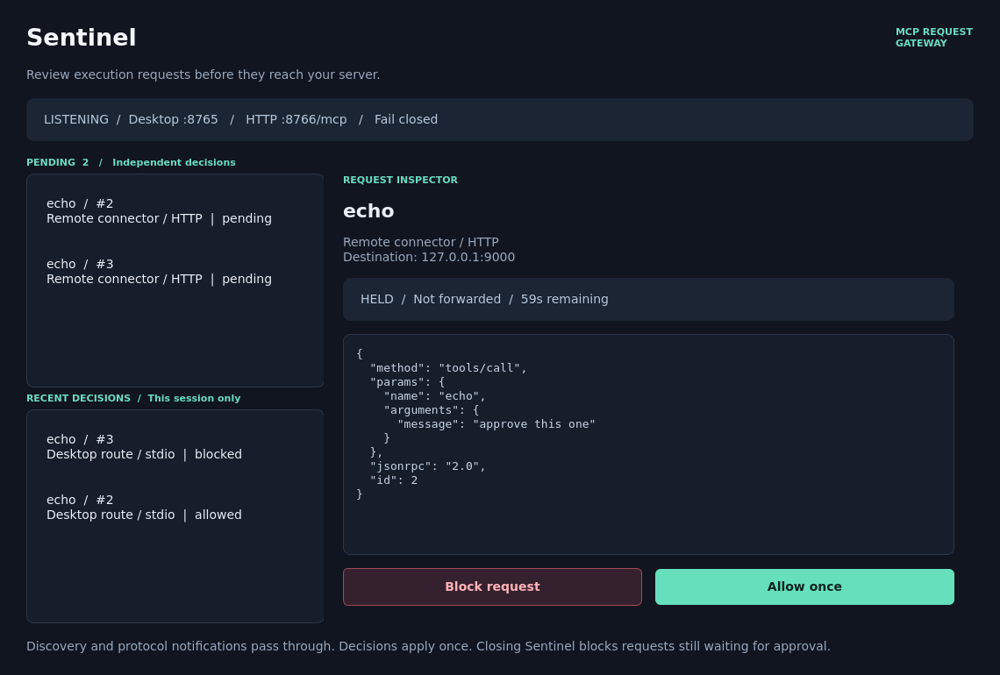

# Sentinel

A Python approval gateway for Model Context Protocol requests. A request waits in memory until you choose **Allow once** or **Block request** in a native, always-on-top window. Only an approved request reaches its configured MCP server.

Sentinel sits in the connection path. It does not scrape Claude's UI, inspect TLS traffic, or depend on a browser extension.



## What is implemented

- **Desktop route:** a newline-delimited stdio proxy that Claude Desktop can launch instead of the original MCP server. It starts that server as a child process, preserves stdout for MCP messages, and sends logs to stderr.
- **Web route:** an authenticated Streamable HTTP reverse proxy at `/mcp`. With an HTTPS tunnel, Claude's cloud connector can reach this local gateway while approval stays on your computer.
- **Concurrent decisions:** each held request has its own future and internal ID. Approving one does not release the others. Decisions can finish in any order, including requests with the same JSON-RPC ID on separate stdio connections.
- **Fail closed:** block, decision timeout, queue capacity, shutdown, cancellation, or an unavailable approval service do not grant permission. No automatic retry of an upstream operation.
- **Two policies:** the default prompts for execution requests; `--gate-all` prompts for every client request, including initialization and discovery. Notifications and JSON-RPC responses are relayed, not turned into approval requests.
- **Inspection:** exact JSON-RPC payload, destination, transport route, countdown, pending queue, and the last 100 authorization decisions for this session.

### Tested versus configured

| Path / environment | Status |
| --- | --- |
| Python 3.12, Linux; native Qt app rendered through X11 | Tested |
| Official MCP Python SDK client -> stdio proxy -> FastMCP server | Tested: initialize, list, concurrent allow and block |
| Official MCP Python SDK client -> HTTP gateway -> FastMCP server | Tested: initialize, list, concurrent allow and block |
| HTTP JSON and SSE responses, session/version headers | Automated tests |
| Queue isolation, timeout, shutdown, malformed input, authentication, Origin checks, client cancellation | Automated tests |
| Popup behavior, independent buttons, no request swap during review | Automated Qt tests |
| Claude Desktop application on Windows/macOS | Configuration provided; not yet exercised in the actual application |
| claude.ai -> public HTTPS tunnel -> gateway | Setup provided; not yet exercised with a live Claude account |
| OS-level foreground behavior on Windows/macOS/Wayland | Needs verification on the recording machine |

The screenshots below show the real gateway handling requests from the official SDK clients, not screenshots of Claude. Route labels describe the adapter, not an authenticated claim that a particular Claude application sent the request. See [the captured demo output](docs/demo-output.txt) for actual allowed results and denied responses.

## Run locally

Use Python **3.11 or newer** with a desktop session. Python 3.12 is the tested version.

```bash
git clone https://github.com/vedant48/mcp-sentinel.git
cd mcp-sentinel
python -m venv .venv
```

Activate the environment:

```bash
# macOS / Linux
source .venv/bin/activate

# Windows PowerShell
.venv\Scripts\Activate.ps1
```

Install the application and the demo/test dependencies, then create its local credentials:

```bash
python -m pip install -e ".[dev]"
sentinel init
```

For the exact Python 3.12 dependency set used in testing:

```bash
python -m pip install -r requirements-dev.lock
python -m pip install --no-deps -e .
```

On a minimal Ubuntu system, Qt's X11 backend may also need `libxcb-cursor0`:

```bash
sudo apt install libxcb-cursor0
```

Start Sentinel:

```bash
sentinel run
```

This is sufficient for the stdio route. To try HTTP too, start the example upstream in a second terminal:

```bash
python examples/demo_server.py --http
```

Restart Sentinel with that upstream configured:

```bash
sentinel run --upstream http://127.0.0.1:9000/mcp
```

The demo server offers `echo` and `slow_echo`. Neither reads files nor changes external state.

### Try approval and blocking without a Claude account

With Sentinel running, use a new terminal in the same environment:

```bash
python examples/demo_client.py stdio
```

1. The client initializes and lists tools without a popup in the default policy.
2. A popup appears for `echo("approve this one")`. Leave it pending briefly: the client waits and the server has not received the call.
3. Click **Allow once**. The client prints `Echo: approve this one`.
4. Click **Block request** for the next call. The client prints the denial instead of an echo result.

Repeat through the HTTP path, with the HTTP upstream running and configured:

```bash
python examples/demo_client.py http
```

For two requests pending at the same time:

```bash
python examples/demo_client.py stdio --concurrent
python examples/demo_client.py http --concurrent
```

Run those one at a time for a clear demo, or in separate terminals to exercise both routes together. Select a queue row to inspect that request. The JSON-RPC ID helps distinguish calls to the same tool. A new arrival will not replace the request already displayed in the popup.

## Claude Desktop setup

Run the gateway GUI before making tool calls. Generate a config snippet with correct absolute paths for your checkout and virtual environment:

```bash
python scripts/desktop_config.py
```

In Claude Desktop's developer settings, open the MCP configuration file. Merge the generated `sentinel-demo` entry into the existing `mcpServers` object, preserving other servers. Restart Claude Desktop completely after saving.

Typical config locations:

- macOS: `~/Library/Application Support/Claude/claude_desktop_config.json`
- Windows: `%APPDATA%\Claude\claude_desktop_config.json`

Enable the Sentinel demo tool in Claude, then ask:

> Use the sentinel-demo echo tool with the message "desktop approval check".

Allow the request in Sentinel. Ask again with `desktop blocked check`, then block it. Claude may ask its own tool permission first; Sentinel's approval is a second, independent boundary.

To wrap an existing stdio MCP server, retain the Sentinel portion of the generated entry and replace only the command after `--` with that server's original command and arguments. Keep any environment variables the upstream needs in the entry's `env` object. Remove or disable the original direct server entry so Claude cannot select an unguarded route instead.

The wrapper uses `create_subprocess_exec`, not a shell. Executable paths and arguments must be separate JSON array elements. On Windows, use an executable such as `node.exe` with its script path rather than relying on shell aliases or `.cmd` expansion.

## Claude Web setup

**A localhost URL is not enough.** Claude's custom remote connector connects from Anthropic's infrastructure, even when it is configured in a desktop client. It needs a publicly reachable HTTPS endpoint on port 443.

1. Run the HTTP example server on `127.0.0.1:9000`.
2. Run `sentinel run --upstream http://127.0.0.1:9000/mcp`.
3. Expose **only port 8766** with an HTTPS tunnel that supports SSE. For example, with [ngrok installed and authenticated](https://ngrok.com/docs/gateway/agent/expose-a-service):

   ```bash
   ngrok http 8766
   ```

4. Take the HTTPS hostname printed by the tunnel and append `/mcp`.
5. In Claude's Connectors settings, add a custom web connector with that URL.
6. Configure a fixed request header named `Authorization`, with value `Bearer ` followed by the contents of `remote.token`. Use the connector's fixed-header authentication option, not an interactive OAuth login. Current Claude help describes this under request headers; the exact menu can vary by account.
7. Enable the connector in a chat. Ask Claude to call `echo` with `web approval check`, allow it, then call it with `web blocked check` and block it.

`sentinel init` prints the credential file locations without printing their contents. By default they are under `~/.config/mcp-sentinel/`, including on Windows. Read the remote token locally when configuring the connector. Do not commit it, place it in a URL, or include it in the recording. Never expose port **8765**: that is the private local approval channel for stdio wrappers.

If your Claude account does not offer fixed request headers, this build does not supply an OAuth server as a substitute. Do not remove authentication to make the demo work. Demonstrate the HTTP path with the official SDK client instead and state that the live Claude Web connection remains unverified.

Use the hostname actually printed by your tunnel. Stop the tunnel after the demo. The tunnel operator terminates public HTTPS, so treat it as part of the trust boundary. Cloudflare **Quick Tunnels** are not a drop-in alternative: [their own documentation says they do not support SSE](https://developers.cloudflare.com/tunnel/get-started/quick-tunnels/). Use an SSE-capable tunnel or a properly configured HTTPS reverse proxy instead.

## Approval policy

By default, these client requests pass through without a confirmation:

```text
initialize
ping
tools/list
resources/list
resources/templates/list
prompts/list
```

Everything else with a request ID and method requires approval, including unknown extension methods, `tools/call`, `resources/read`, `prompts/get`, and completion requests. There is no persistent allowlist and no "always allow" button.

For the literal every-request workflow, enable `--gate-all` on each adapter:

```bash
# HTTP adapter
sentinel run --gate-all --upstream http://127.0.0.1:9000/mcp

# Desktop config, including the stdio adapter flag
python scripts/desktop_config.py --gate-all

# A manually launched stdio adapter
sentinel stdio --gate-all -- python examples/demo_server.py
```

With this mode, approve initialization and tool discovery before the tool call appears. Responses to server-initiated requests and protocol notifications must still flow without user interaction or the protocol can deadlock. Approval on the HTTP adapter does not change the separate stdio adapter's policy; set the flag in both places when using both routes.

### Other options

```bash
sentinel run --help
sentinel stdio --help
```

- `--decision-timeout 90`: time to decide, between 1 and 120 seconds. An MCP client's own timeout may be shorter, so decide promptly.
- `--upstream-token-file PATH`: a separate upstream bearer credential. Incoming gateway credentials are never reused as upstream credentials.
- `--origin https://example.com`: explicitly allow that browser Origin. Origin checks are independent of bearer authentication. Claude's server-to-server route normally does not require a browser Origin allowance.
- `--control-token-file PATH`, `--remote-token-file PATH`: override local credential paths.
- `SENTINEL_CONFIG_DIR`: change the default credential directory. When a client sanitizes child environments, pass the token-file argument explicitly.

## Screens

### Ready



### Two requests held, neither forwarded



### One allowed, the other still pending



"Allowed" records authorization, not a claim that an upstream operation succeeded. Its actual result is returned to the MCP client. The demo output shows the successful echo response.

### Blocked, with an explicit denial



### HTTP requests held by the same local approval window



## Tests

```bash
pytest -q
ruff check .
ruff format --check .
```

Tests include real child processes, actual HTTP listeners, official MCP SDK clients, a FastMCP upstream, and Qt widget behavior. GUI tests use Qt's offscreen backend so they can run without a display. They verify the topmost window flag; they cannot prove how every OS window manager handles foreground focus.

The HTTP SDK integration test uses local port 9000. Stop the manual example server before running tests.

## Boundaries and limitations

- Sentinel guards only clients explicitly configured to use it. A direct connection to an upstream server bypasses it. It is not system-wide endpoint enforcement.
- The Web route is **Streamable HTTP**, including JSON/SSE responses and legacy session headers. The older, separate HTTP+SSE `/sse` plus `/messages` transport is not an ingress supported by this build.
- HTTP upstreams stay HTTP; stdio upstreams stay stdio. This is not a stdio-to-HTTP transport translator.
- Static bearer credentials are suitable for this single-user demonstration. There is no OAuth server, multi-user identity, RBAC, credential refresh, or hardened public deployment setup.
- The popup asks the OS to stay above other windows. Fullscreen applications, secure desktops, focus-stealing prevention, and Wayland policies can override that. The pending dashboard remains available; closing the popup does not approve or deny a request.
- Pending calls expire after the configured deadline. A client disconnect/cancellation cancels a held request. Once an approved request has been forwarded, cancellation or closing Sentinel cannot guarantee undoing server-side effects. Never retry a write just because its outcome is uncertain.
- The GUI stores payloads in memory for the session, including recent decisions. It does not persist them to an audit database. Secrets within tool arguments will be visible to the person reviewing the request. Queue capacity is 64, recent history is 100, and a message body is limited to 1 MiB. Compressed HTTP request bodies are rejected; compressed upstream responses are relayed unchanged.
- The actual Claude clients and Windows/macOS behavior need a final hands-on check before claiming them as tested in a submission.

## Design and recording

- [Architecture and trade-offs](docs/ARCHITECTURE.md)
- [Demo recording script](docs/DEMO_SCRIPT.md)
- [Observed demo results](docs/demo-output.txt)

### Protocol references

- [MCP transport specification](https://modelcontextprotocol.io/specification/2025-11-25/basic/transports)
- [MCP lifecycle and timeouts](https://modelcontextprotocol.io/specification/2025-11-25/basic/lifecycle)
- [MCP cancellation](https://modelcontextprotocol.io/specification/2025-11-25/basic/utilities/cancellation)
- [MCP tools and human approval](https://modelcontextprotocol.io/specification/2025-11-25/server/tools)
- [Official Python SDK](https://github.com/modelcontextprotocol/python-sdk)
- [Claude remote connector requirements](https://support.claude.com/en/articles/11175166-get-started-with-custom-connectors-using-remote-mcp)
- [Desktop versus web connectors](https://support.claude.com/en/articles/11725091-when-to-use-desktop-and-web-connectors)
