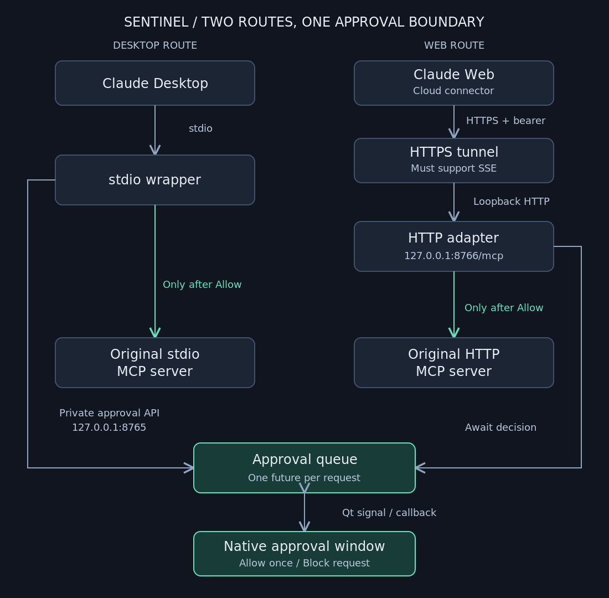
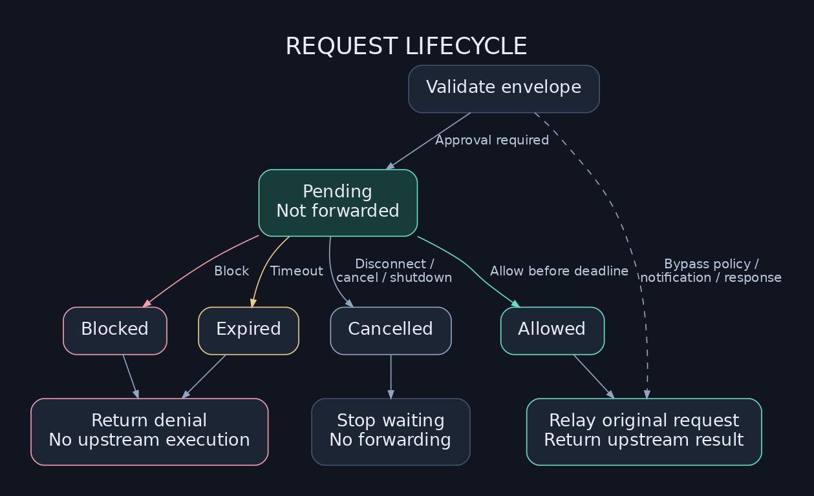

# Architecture

## Placement, not packet capture

MCP uses JSON-RPC, but its two main transports have different process and network boundaries. A Desktop stdio server is a child process with newline-delimited messages on stdin/stdout. A remote connector sends HTTP requests from the provider's cloud. A browser extension cannot observe that cloud-to-server connection, and a local packet sniffer cannot put a reliable authorization boundary inside encrypted traffic.

Sentinel therefore becomes the configured MCP endpoint. The original server is reachable through the gateway only after a decision. This makes the approval point explicit and testable without impersonating Claude or decrypting its traffic.

The tunnel exposes the data listener, never the control listener. Both listeners bind to loopback by default. Deploying the GUI elsewhere would change the meaning of "local user approval" and is outside this build.

## Components

| Module | Responsibility |
| --- | --- |
| `approval.py` | Pending requests, policy predicate, deadlines, bounded history, one-shot decisions |
| `gateway.py` | Private control API and authenticated Streamable HTTP forwarding |
| `stdio.py` | Upstream child lifecycle, bidirectional relay, concurrent per-request authorization |
| `gui.py` | Qt dashboard and topmost popup; background asyncio service lifecycle |
| `cli.py` | Configuration, credential creation, entry points |

The application does not use the MCP SDK as a proxy framework. It preserves the JSON-RPC envelope rather than re-creating each tool schema or emulating the upstream's capabilities. This keeps unknown methods, opaque results, capability negotiation, and server-initiated traffic with their original owner. The official Python SDK is instead an independent interoperability check in the tests and examples.

## Request lifecycle

For each gated request:

1. Validate a single JSON-RPC object and enforce the input size limit.
2. Copy its payload into a `Pending` item. An internal UUID identifies the approval independently of the client's JSON-RPC ID.
3. Create an asyncio future and publish a GUI snapshot. No upstream call happens yet.
4. Wait for that future, not a blocking GUI dialog or a polling loop.
5. A decision resolves only that item's future. An allow arriving after the monotonic deadline becomes an expiration, not permission.
6. On Allow, forward the original request. On Block or expiration, return a JSON-RPC error with the original ID and application code `-32001`.
7. Remove the item from pending and retain its authorization outcome in the bounded in-memory history.

For stdio, the original newline-delimited bytes are held and later written unchanged. For HTTP, the original body bytes are held and later sent unchanged. A failed upstream operation is not retried, because a timed-out write may already have taken effect.

"Allowed" in the dashboard is deliberately an authorization outcome. It does not mean the server completed the operation. Results and errors go back to the MCP client through the original transport.

## Concurrency model

There are two event loops with a strict ownership boundary:

- **Qt's main thread owns widgets.** It never runs network requests or waits for an approval future.
- **One background asyncio loop owns the gateway and approval queue.** HTTP handlers await independent futures. The GUI receives snapshots through Qt signals and submits decisions through `loop.call_soon_threadsafe`.

A stdio wrapper is a separate process for each Desktop server connection. It runs its own asyncio loop and asks the GUI service for approval over the authenticated loopback control API. A small daemon reader thread adapts stdin into that loop, including on platforms where asyncio cannot register stdin as a pipe. The child process uses asyncio subprocess pipes.

The wrapper's read loop does not wait for a tool decision. It creates a task for the held request and keeps reading, so notifications, cancellation, client responses, and unrelated requests can continue. A write lock prevents multiple tasks from mixing bytes on the upstream pipe. Upstream messages are relayed concurrently to stdout; diagnostics never use stdout.

Concurrency identities differ by boundary:

- Approval queue: an internal UUID per request.
- Stdio request tasks: JSON-RPC ID, scoped to that wrapper process.
- HTTP request tasks: `(Mcp-Session-Id, JSON-RPC ID)`, preserving string versus integer IDs.

Duplicate active IDs in the same connection/session are rejected instead of overwriting an existing approval. Different stdio connections can use the same ID safely. Sessionless HTTP calls sharing a credential and ID are conservatively treated as duplicates while one is active; independent HTTP clients should use upstream sessions and unique active IDs.

There is a maximum of 64 pending approvals and 100 history entries. A slow reviewer cannot create an unbounded approval queue. A new request does not replace the popup's current payload while a person is reading it, which avoids approving a different request just as it arrives.

## Transport behavior

### Stdio

The wrapper launches the configured upstream with `create_subprocess_exec`, without a shell. It preserves the upstream's initialization response and capabilities, discovery results, execution responses, and server-to-client messages. EOF or process exit shuts down the other relay direction and terminates the owned child, with a kill fallback after a grace period.

When the approval service is unavailable, execution requests receive a denial. Default-policy discovery still passes through. In `--gate-all` mode, initialization is held too and an unavailable approval service denies it.

### Streamable HTTP

The gateway exposes `/mcp` and proxies to one operator-configured HTTP endpoint:

- `POST`: inspect JSON-RPC requests, hold those requiring approval, then relay JSON or SSE responses.
- `GET`: relay the upstream's server event stream when it supports one.
- `DELETE`: relay session termination.

Session IDs, negotiated protocol-version headers, content types, SSE event framing, and `Last-Event-ID` pass through. Response chunks are relayed as they arrive, not buffered until the stream completes. Content encoding is retained without transparently decompressing the response body. Redirects are refused so a client cannot be redirected around the approval gateway.

The upstream remains responsible for capability negotiation, session validity, protocol-version support, tool schemas, progress messages, and execution. The proxy implements the Streamable HTTP shape exercised with the SDK and the linked 2025-11-25 transport specification. It does not claim to implement a separate legacy `/sse` transport or every later draft feature.

Incoming gateway authorization is removed before forwarding. An optional, separate upstream bearer credential is supplied from a local file. Hop-by-hop headers and browser cookies are not forwarded; upstream cookies are not exposed to clients. The gateway does not implement an OAuth authorization server.

## Policy

The normal policy bypasses initialization, ping, and listing methods. This avoids turning initial connection and tool discovery into a stack of prompts. All execution methods and unknown request methods are gated. That includes resources and prompts, not only tools.

`--gate-all` changes the predicate to include every client request with an ID and method, including initialization. It is available on each adapter so the assignment's literal every-request workflow can be demonstrated. Notifications and responses are not requests and remain live in either mode. Treating them as approvals would break cancellation and server-to-client interactions.

No decision changes future policy. Approving a tool once does not approve its next invocation, its other arguments, or another tool with a similar name.

## Security boundary

The control API has no remote "allow" endpoint. It accepts approval submissions authenticated with a local control token and rejects browser Origin headers. Decisions originate in the native GUI. The HTTP data listener uses a different bearer token and an explicit Origin allowlist. A malicious webpage cannot use an arbitrary Origin to reach it simply because it knows a URL.

Credential files are created exclusively, without overwriting existing files. On POSIX their creation mode is `0600` and the new directory is `0700`; Windows relies on the user's profile ACLs. Credential values are not printed by initialization. Request payloads and decisions remain in process memory and are not written to a persistent audit log.

This is a single-user proof of concept, not a hostile multi-tenant service. A compromised local process running as the same OS user is outside the boundary. So are a malicious upstream, a bypass connection configured in Claude, an exposed control port, and a stolen bearer token. The popup presents untrusted request fields as plain text and a JSON text view, never as executable content or rich markup.

Cancellation is best effort once execution begins. It can remove a request still awaiting approval, but it cannot undo a server-side write already performed. The same applies to shutting down the GUI after approving a call. No UI language promises rollback.

## Trade-offs and next steps

- **Transparent relay over schema reimplementation:** fewer protocol assumptions and better compatibility, but no semantic argument validation beyond envelope checks. The upstream owns tool schemas.
- **Native Qt over a web approval page:** a separate topmost window and no browser decision endpoint, at the cost of a larger dependency and OS-specific window behavior.
- **Local gateway plus tunnel over a cloud-only gate:** approval remains on the user's machine, but the machine and tunnel must remain running for Claude Web. Public deployment would need supported OAuth, per-user authorization, rate limits, and operational monitoring.
- **Static credentials over OAuth:** keeps the demonstration small and explicit; limits live connector compatibility to accounts that can send a fixed authentication header.
- **Session-only history over a database:** avoids persisting sensitive arguments and keeps setup simple; a production audit trail would need explicit retention, redaction, access controls, and execution outcomes distinct from authorization outcomes.

The next acceptance check is a live run from Claude Desktop and claude.ai on the recording machine. That validates client configuration, connector authentication, real timeout behavior, and foreground behavior that protocol tests alone cannot establish.
